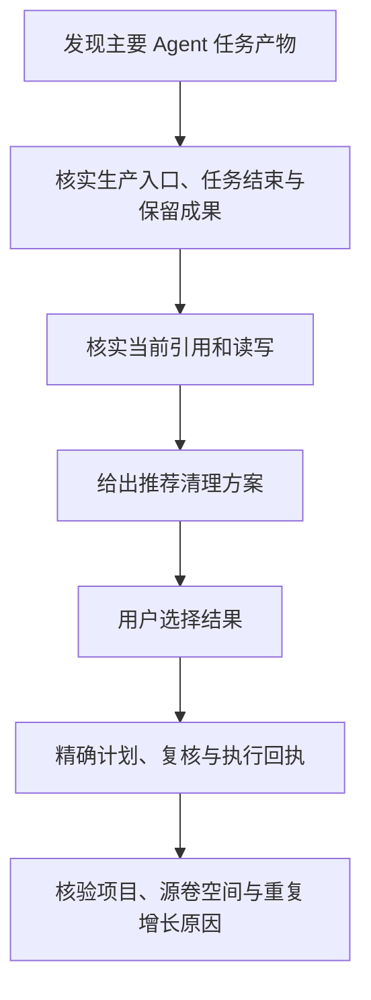

# Agent 开发产物清理 · Codex Project Storage

[English](README.en.md) · [安装](docs/INSTALLATION.md) · [使用示例](docs/QUICKSTART.md) · [安全边界](docs/SAFETY.md)

[](https://github.com/SoberAming/codex-project-storage/actions/workflows/ci.yml)

**清理 Agent 开发和执行任务留下、经核实已经无效或冗余的文件，及时腾出空间，保留项目与有效成果。**

适用于排查使用 Codex、WorkBuddy、Claude Code、Kimi Code 等 Agent 时积累的任务产物。Agent 负责查明生产工具、对应任务、结束记录、保留成果、引用与读写；用户决定是否采用推荐结果。项目目录用于限定范围，不把普通文档归档或迁移业务素材当成默认清理。



## 重点识别什么

| 来源 | 判断方式 |
| --- | --- |
| 临时截图、录制、浏览器轨迹 | 区分任务废弃产物与唯一成果、验收或排错证据 |
| 下载碎片与任务暂存文件 | 绑定真实生产入口、对应运行与结束记录，不按后缀单独删除 |
| 重复预览、解码帧、构建和测试线索 | 查当前用途、来源和读写，未知或仍在使用的保留 |
| 隔离测试数据库 | 区分已结束的合成测试 data 与当前业务数据库、恢复链 |
| 工具缓存与环境 | 查真实工具、版本、独占归属；依赖、共享缓存与未知布局不通用删除 |

画像新增 `agent_residue_review`，复用已有互斥计量生成残留审查队列，优先解释大的运行产物。名称、年龄、扩展名和体积都只是线索。报告分别记录候选占用、已核实计划收益和实际释放。

## 当前可执行的路线

| 产物 | 支持范围 |
| --- | --- |
| 已结束 Agent 任务的限定残留单元 | 新的 [agent_artifact_guard](references/agent-artifacts.md)：限定截图/录制/轨迹、下载碎片、暂存类型；真实生产与终止证据、保留成果、无引用与读写、完整成员和哈希核验后精确处理 |
| CPython 缓存 | 对应源码存在，满足解释器格式、年龄、身份和保护规则 |
| 可在本地确定重建的媒体中间产物 | 保留输入和生产依据，按原有专用规则处理 |
| 合成 PostgreSQL 测试 data | 只处理独立生命周期正向核验的 data，保留生产器、日志、结果及恢复资料 |
| 项目独占 pip/npm 缓存 | 各自支持版本及生产/归属合同；原生清理不等于可清空共享缓存 |
| 有保存价值的停用产物 | 按需迁移，完整校验并验收用途后释放源 |

新任务残留路线不设统一 48 小时等待；及时处理依赖真实终止证据和当前静止条件。旧字节码、媒体和数据库路线保持各自规则。并非所有识别类别都有自动清理执行器；没有支持路线时继续分析并给出专用建议。

## 使用

需要 Python 3.10+，以及能加载本地 Skill 并运行脚本的 Agent。把完整目录放进宿主实际支持的技能位置，详见[安装指南](docs/INSTALLATION.md)。

在具体项目里先调用：

```text
使用 codex-project-storage，分析本项目中 Agent 开发留下的无效产物。重点检查失败任务残留、临时截图和录制、下载碎片、预览、重复测试环境及工具缓存。你核实来源、任务状态、保留成果和引用，给我一个清理推荐方案，说明空间收益与影响。先只分析，保护项目、有效成果、会话和索引。
```

看过具体清单后可说“按推荐清单执行，条件变化就停止”。用户无需手工挑文件 ID 或输入哈希；内部计划与校验由 Agent 管理。Codex 可显式用 `$codex-project-storage`，其他宿主的入口不同。

## 保护边界

- 源码、原始素材、唯一生成结果、当前交付物、验收基准、会话、索引、业务/状态数据库、凭据及恢复资料默认保护。
- 不清空整个 `outputs`、`.runtime` 或 Agent 用户目录；仅处理精确、经过核实的支持单元。
- 计划绑定授权范围、成员、身份和内容；证据、引用、读写或存储条件改变即停止，保留回执。
- 不自动停止应用、提权、改配置、创建兼容链接、截断历史或设置后台清理。
- 复制后留源、同卷改位置不计入释放；逻辑字节与源卷实测空间变化分别报告。

跨 Agent 的保守状态边界与显式自定义状态根见[安全设计](docs/SAFETY.md)。启动任务的 Agent 和实际写文件的工具分开识别，不将 npm、浏览器或渲染器产物假称为 Codex 内置缓存。

## 验证与适用范围

源码 CI 在 Windows/macOS × Python 3.10/3.13 四个托管组合运行真实隔离测试、精确清理 CLI、状态保护检查和安装包构建。请核对[对应提交的检查](https://github.com/SoberAming/codex-project-storage/actions/workflows/ci.yml)与[兼容性说明](docs/COMPATIBILITY.md)，发布附件绑定具体提交和平台结果。绿色默认分支徽章不能替代另一提交的验收。

多 Agent 的任务产物是分析对象；Windows/macOS 脚本验证不代表已经在每种 Agent 宿主内完成调用、权限和业务验收。macOS 协作锁不能阻止非协作写入，必须确认静止；个人外盘、完整 APFS 共享块/快照和真实业务流程仍需具体核实。工具不能保证任意项目绝对无风险。

## 开源

MIT 许可证。独立社区项目，与各 Agent 厂商无隶属关系。

[贡献指南](CONTRIBUTING.md) · [安全报告](SECURITY.md) · [支持](SUPPORT.md) · [1.5 升级说明](docs/RELEASE_NOTES_v1.5.0.md)
