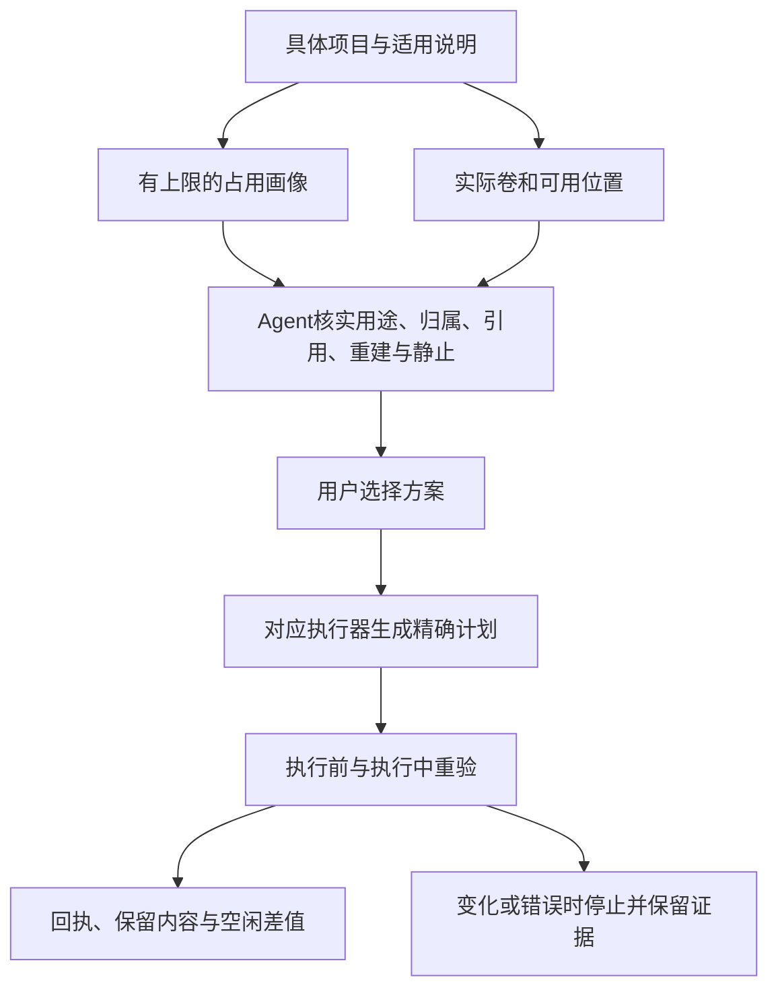

# 架构与证据流

`SKILL.md`提供Agent决策和路由；执行器承担具体的边界、快照和重验。画像、人工业务结论与可执行计划是不同层次。

| 模块 | 输入与用途 | 写操作 |
| --- | --- | --- |
| `volume_advisor.py` | 实际项目路径、候选目标、用户容量目标 | 仅新报告 |
| `project_profiler.py` | 有预算元数据、允许配置片段、明确关联根 | 仅新报告，不执行项目命令 |
| `storage_guard.py` | 窄范围缓存扫描、选中ID、精确计划 | 合格CPython缓存逐文件删除 |
| `generated_artifact_guard.py` | 真实生成依据、输入、精确媒体中间件范围 | 满足条件的媒体中间产物逐文件删除 |
| `native_cache_guard.py` | 真正项目独占的专用pip缓存与生产证据 | 固定可信原生命令，范围快照和单次消费 |
| `npm_cache_guard.py` | 项目独占npm内容缓存、可信工具和保留的真实生产证据 | 同卷隔离后原生清理，保留日志；单次计划、失败位置与字节回执 |
| `retired_runtime_guard.py` | 正向证明可丢弃的合成PG测试data及保留证据 | 完整清单、阶段复核和逐项保护，不逐文件重扫全树 |
| `relocation_guard.py` | 已停用产物、保留目标、用途证据 | 复制、验收和逐文件释放分阶段 |

## 画像与扫描

全面画像计入受保护目录的大小；缓存专用scan刻意跳过依赖、素材等目录，以免用可删候选扫描遍历全部依赖。不能将两个扫描器不同覆盖口径的总量相减后称作增长。

画像的`nodes`是互斥归属分区。项目、明确关联目录与全局共享线索分列，硬链接按已知身份去重。外部候选默认只发现存在性，不默认递归测量。`coverage.complete=false`表示全局语义/归属未全部完成；元数据遍历完整程度另列，独立核验完整的候选子树仍可进入执行器。

`review_priorities`按类别汇总已有分区，确保主要占用得到解释。它不证明可丢弃，不输出授权收益，也不读取更多正文。大项缺少受支持操作或生命周期证据时，报告明确缺口、保留方案和可继续核实的步骤，避免只返回很小的pyc方案。

## 执行合同

- 计划固定具体源、保留结果、卷/目录/文件身份、成员、预算和相应内容证据。
- 源变化、范围增加、身份漂移、锁冲突、I/O错误或断连时停止；不自动强制重放。
- 原生清理计划绑定原生工具范围，不伪称其内部操作是固定逐文件unlink清单。
- 输入和生产依据不等于无条件可重建证明，Agent仍需核实业务语义与依赖。
- 迁移内容校验成功后仍有用途验收，不能把copy成功当项目已经可用。

逐项合同与CLI用法见[操作说明](../references/operations.md)、[生成产物](../references/generated-artifacts.md)、[pip缓存](../references/native-cache.md)、[npm缓存](../references/npm-cache.md)、[测试运行退役](../references/retired-runtime.md)和[迁移](../references/relocation.md)。

## 扩展原则

新增生态先增加有预算的只读归因，不默认扩大删除白名单。加入执行能力时定义独立合同、官方机制依据、保护边界、故障/竞态测试与真实样本验证。避免让宿主特有API成为所有用户的必需依赖；工作树管理仅在宿主实际支持时路由。

## Agent 任务产物主线（1.5）

`project_profiler.py`复用互斥分区建立`agent_residue_review`，发起Agent未知时明确未知。Agent沿真实生产入口补任务、结束状态、保留结果和当前用途，再选择精确执行器。`agent_artifact_guard.py`负责支持任务单元的plan/apply，不执行生产代码，不开放任意递归删除。其他执行器的独立白名单不因新画像扩大。共享`storage_guard.py`集中保护状态根和管理IO，npm/pip及测试退役路线复用此边界。
